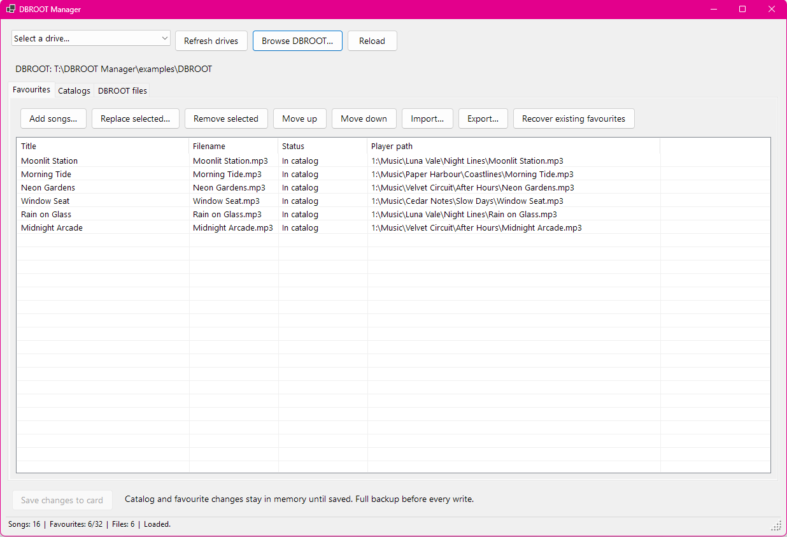
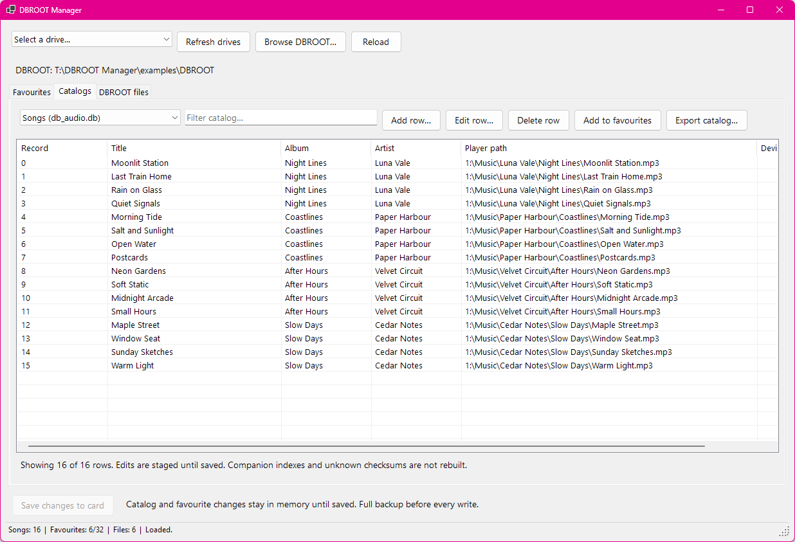
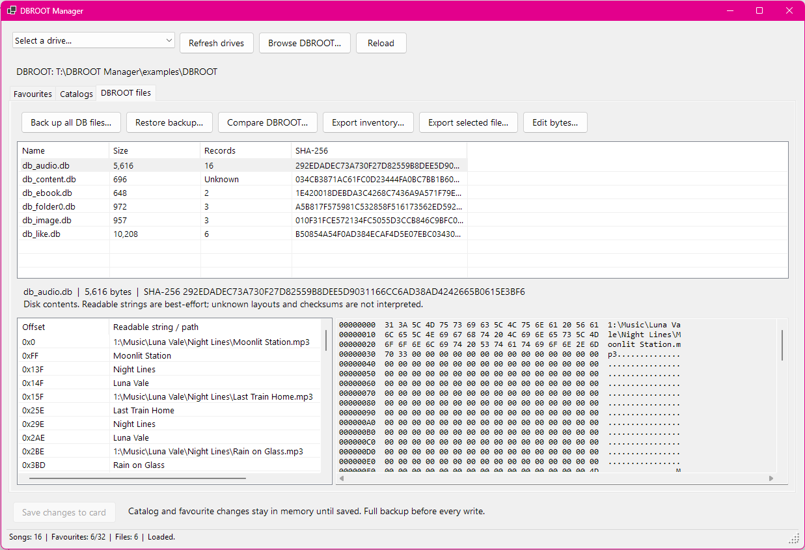

# DBROOT Manager

A .NET app for browsing and editing the DBROOT database of JointsBee/Smartlink SL6801/SL6806 MP3 player devices (aka "YP3" devices). Organise favourites, edit catalogs, and inspect database files. This tool can also restore favourites from a backup that are lost when an "Update Playlist" function is performed and can manually edit components of the DBROOT database.

| Favourites | Catalogs | DBROOT files |
| :---: | :---: | :---: |
| <a href="Images/favourites.png"></a> | <a href="Images/catalog.png"></a> | <a href="Images/dbroot.png"></a> |

## Getting started

1. Download the **.NET 10 Desktop Runtime** from [here](https://dotnet.microsoft.com/en-us/download/dotnet/10.0/runtime).
1. Download the **DBROOT.Manager-win-x64.zip** package from this repository's **Releases** page.
2. Extract the whole ZIP into a folder on your PC, then open **DBROOT.Editor.exe**.
3. Connect your player's storage and choose its drive, or use **Browse DBROOT…** to select the DBROOT folder or its parent.

You can also open a folder directly:

```powershell
.\DBROOT.Editor.exe "E:\DBROOT"
```

## Usage

- **Favourites** — Add songs, drag files into the list, replace or remove entries, and change their order. Import and export JSON or text lists. **Recover existing favourites** reloads surviving favourites from the card (Only applies to some SL6806 devices that do not wipe the favourites database itself from a auto-rescan) and synchronises their player count; save or reload any staged edits first. Favourites can be exported and imported. Importing favourites will modify the databases so that the player doesn't rescan automatically.
- **Catalogs** — Browse and filter songs, favourites, images, e-books, and root folders. Add, edit, or delete records, send songs to favourites, and export catalogs as CSV or JSON.
- **DBROOT files** — View file sizes, record counts, hashes, readable strings, and hex data. Create or restore ZIP backups, compare folders, export files or an inventory, and edit raw bytes.

Favourite and catalog edits stay staged until you click **Save changes to card**. Saves, raw byte edits, and restores create a verified backup first. Automatic backups live in `%LOCALAPPDATA%\DBROOT Manager\Backups`; use **Restore backup…** to restore one.

## Running from source

Install the **.NET 10 SDK** on Windows, then run this from the repository folder:

```powershell
dotnet run --project .\DBROOT.WinForms\DBROOT.WinForms.csproj
```

## License

DBROOT Manager is licensed under the [GNU General Public License v3.0 or later](LICENSE) (GPL-3.0-or-later).

